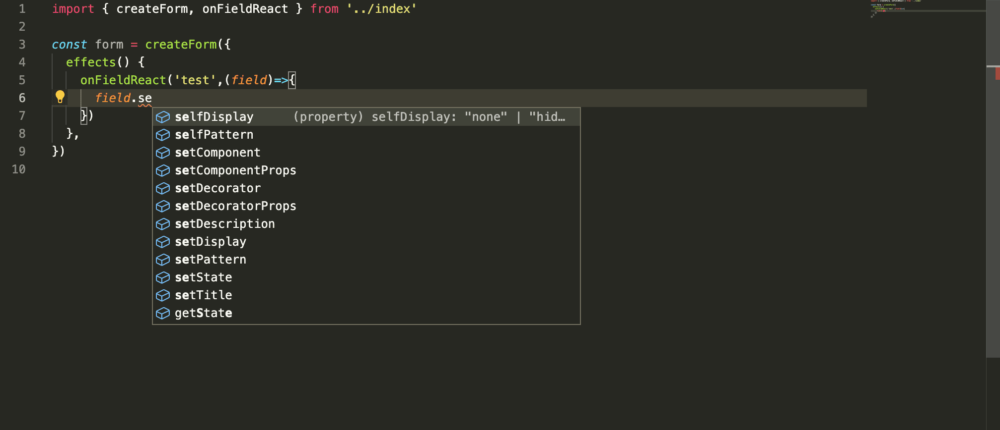
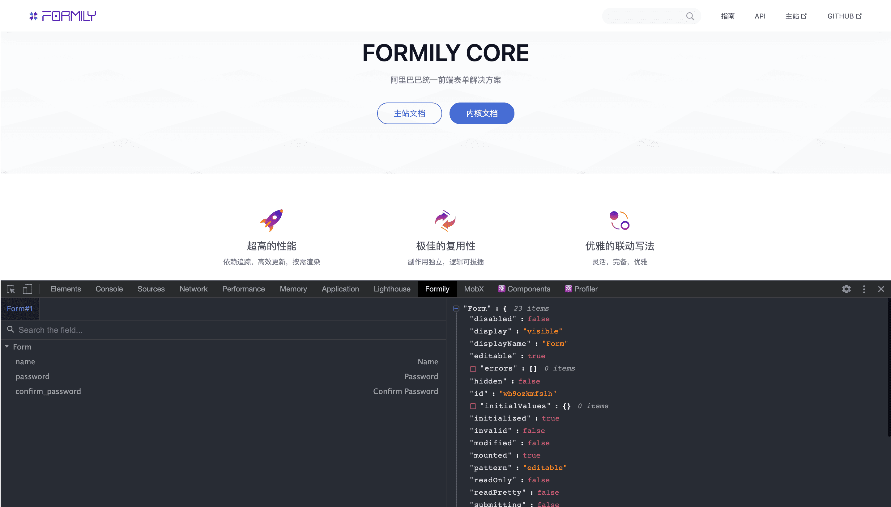

# Introduction

## Pure Core,No UI

Because @formily/core exists as an independent package, its core meaning is to separate the domain model from the UI framework, and at the same time, it can bring the following two intuitive benefits to developers:

1. It is convenient for formily developers to release from the coupling relationship between UI and logic, and improve code maintainability;

2. Allow formily to have cross-terminal and cross-framework capabilities. Whether you are a React user, Vue user or Angular user, you can enjoy the efficiency improvement brought by formily's domain model.

## Ultra high performance

With the help of @formily/reactive, @formily/core naturally gains the ability to track dependencies, update efficiently, and render on-demand. Whether it is under React or Vue/Angular, whether it is frequent field input or field linkage, it can give Users bring O(1) performance experience, developers do not need to care about performance optimization, only need to focus on business logic implementation.

## Domain Model

If we break down the form question, we can actually break it down:

- Data management issues
- Field management issues
- Calibration management issues
- Linkage management issues

The problems in these directions can actually be solved as domain-level problems. Each domain problem is actually a very complex problem. In Formily, all of them are solved by breakthroughs, so you only need to focus on business logic. That's it.

## Smart tips

Because formily is a complete Typescript project, users can develop on VSCode or WebStorm to get the maximum intelligent prompt experience

## Status observable

Install [FormilyDevtools](https://chrome.google.com/webstore/detail/formily-devtools/kkocalmbfnplecdmbadaapgapdioecfm?hl=zh-CN) to observe the model status changes in real time and troubleshoot problems

