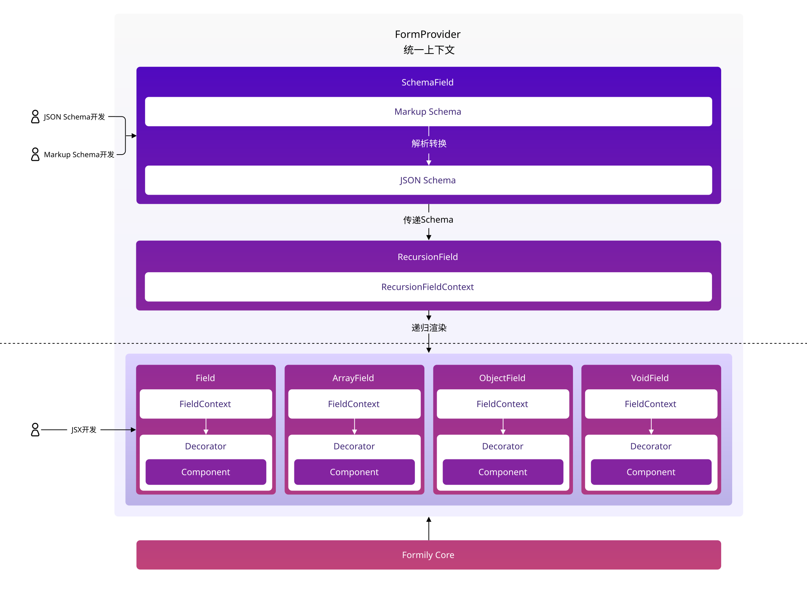

# Core Architecture

The architecture of @formily/react is not complicated compared to @formily/core. First look at the architecture diagram:

From this architecture diagram, we can see that @formily/react supports two types of users, one is pure source code development users, they only need to use the Field/ArrayField/ObjectField/VoidField component. The other type is users who do dynamic development based on JSON-Schema. They mainly rely on the SchemaField component. However, both types of users need to use a FormProvider component to uniformly deliver the context. Then there is the SchemaField component, which is actually the dependent Field/ArrayField/ObjectField/VoidField component inside.
